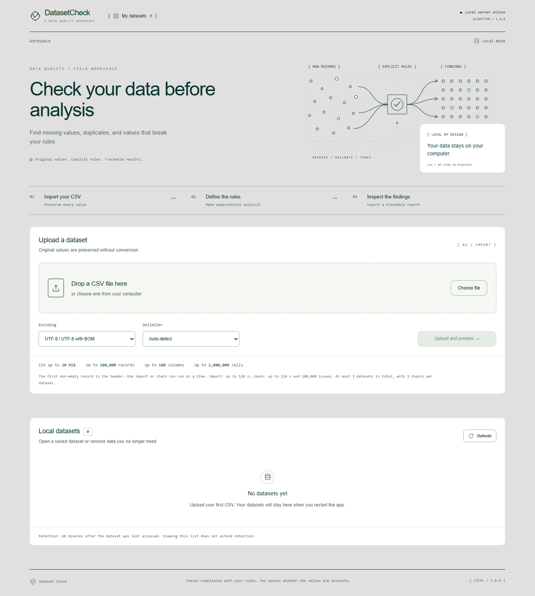

# Dataset Check

A local web application for checking the quality of open tabular data. Upload a CSV without changing its original values, review suggested column types, and validate it against configurable rules. Results include a summary, charts, a filterable issue table, duplicate groups, and three downloadable reports.

**Checks:** required values, exact duplicate records, uniqueness of individual columns, `text / integer / decimal / date` types, and inclusive numeric ranges. Issues and problematic records are counted separately. The application detects rule violations; a result with no issues does not prove that the data is factually accurate.

See the [technical specification v1.1](TECHNICAL_SPECIFICATION.md) for the complete requirements and validation semantics. Excel, automatic corrections, authentication, and public multi-user deployment are outside the MVP scope.



[View an actual validation result: 13 issues in 8 records](examples/screenshots/result.png).

## Interface design

The interface adapts the [Operate](https://operate.so/) visual language using the supplied [Refero style reference](https://styles.refero.design/style/f682f0ea-632d-4d09-bfdf-6a43f5e5a7d8) and the source guidelines in [design/](design/). It uses a sage canvas, forest-green typography, fine chart annotations, and a single mint action color. Navigation sits in a compact horizontal header; tables, forms, and reports share the same visual system.

Design tokens are maintained in `frontend/src/design-tokens.css`. The UI uses local system font fallbacks and original SVG diagrams and icons, without external font or image requests.

## Quick start with Docker

Requires Docker with Compose v2. From the repository root:

```sh
docker compose up --build
```

Open [http://127.0.0.1:8000](http://127.0.0.1:8000). The API and interface share one origin; the port is published only on the local computer. See the [OpenAPI documentation](http://127.0.0.1:8000/api/docs) and [health endpoint](http://127.0.0.1:8000/api/v1/health).

Files and results are stored in the named volume `dataset-check-data`. `docker compose restart` and `docker compose down` preserve it; **`docker compose down --volumes` deletes all user data**.

## Run locally without Docker

Requires **Python 3.12+**, **Node.js 22.13+ or 24**, and **pnpm 11.25.0**. Run commands from the repository root.

Create a Python environment:

```sh
python -m venv .venv
```

Activate it in PowerShell:

```powershell
.\.venv\Scripts\Activate.ps1
```

Or on Linux/macOS:

```sh
source .venv/bin/activate
```

Install dependencies and build the interface:

```sh
python -m pip install -r backend/requirements-dev.txt
npm install --global pnpm@11.25.0
pnpm --dir frontend install --frozen-lockfile
pnpm --dir frontend build
python -m uvicorn app.main:app --app-dir backend --host 127.0.0.1 --port 8000 --workers 1
```

Then open the [application](http://127.0.0.1:8000). `requirements-dev.txt` includes the HTTP client and verification tools. A server that does not need tests can use `backend/requirements.txt`. Once dependencies are installed and the frontend is built, the application runs without external network requests.

For frontend development, run `pnpm --dir frontend dev` in a second terminal and open [http://127.0.0.1:5173](http://127.0.0.1:5173). Vite forwards `/api` to the local backend. Backend `--reload` is suitable for development; an analysis active during a reload fails with a recovery error. The supported deployment uses **one Uvicorn worker**: the coordinator allows one heavy operation and starts a separate child process for it.

## Try the acceptance example

1. Upload [acceptance.csv](examples/synthetic/acceptance.csv) using UTF-8 and the comma delimiter.
2. Mark `id`, `name`, and `population` as required; make `id` unique; set `population` to integer with a range of `0` to `100`; set `opened_at` to an optional date. Keep exact duplicate detection enabled. Use text for `id` and `name`.
3. Run validation. Expect **13 issues in 8 of 9 records**.
4. Filter issues, open an original record and a duplicate group, and download all three reports.
5. Restart the server with the same `DATA_DIR`: the dataset and completed result remain available in the list until their retention period expires.

To reproduce the check through the HTTP API while the server is running:

```sh
python scripts/check_example.py
```

The script compares the complete summary with the [expected result](examples/synthetic/expected_summary.json), downloads all three exports to `benchmark-results/acceptance`, and deletes only its own dataset. Use `--keep` to retain the dataset for inspection in the browser.

The JSON export can restore every field of problematic records after the source dataset has been deleted. The repository includes an [actual JSON report](examples/synthetic/report.example.json) from the acceptance run:

```sh
python scripts/restore_problematic_records.py benchmark-results/acceptance/report-json.json --output benchmark-results/restored.json
```

## Real open data

[examples/open-data](examples/open-data/README.md) contains a snapshot of **Iris** from the UCI Machine Learning Repository, retrieved on **October 19, 2026**, under **CC BY 4.0**, with attribution, a direct source link, and SHA-256. All original observations are preserved; no artificial errors were added.

```sh
python scripts/check_example.py --csv examples/open-data/iris.csv --rules examples/open-data/rules.json --expected examples/open-data/expected_summary.json --output benchmark-results/iris
```

Expect five participants in two exact duplicate groups. Matching rounded plant measurements require interpretation and do not by themselves prove an observation error. The example documentation explains the findings and their limits.

## Verification and performance

Run backend checks, including the browser-independent core:

```sh
cd backend
python -m pytest
python -m ruff check app tests ../scripts
python -m ruff format --check app tests ../scripts
cd ..
pnpm --dir frontend build
```

The frontend build includes TypeScript type checking. For a real browser test, first build the frontend and start the server, then install Chromium and run:

```sh
pnpm --dir frontend exec playwright install chromium
node scripts/e2e.mjs
```

The scenario uploads a CSV, configures rules through the interface, checks the 13/8 result, filters, record and group views, JSON download, and configuration restoration after reload. Artifacts are saved in `benchmark-results/e2e`. Set `E2E_BASE_URL` for another server address or `E2E_HEADED=1` for a visible browser. CI runs backend checks, the frontend build, the API integration scenario, and this browser scenario.

The generator creates deterministic datasets with seed `20261019`, a manifest, and SHA-256 hashes. Large files are generated locally and excluded from Git:

```sh
python scripts/generate_workloads.py
python scripts/benchmark.py --disk "SSD; specify the model" --output benchmark-results/performance.json
python scripts/check_budgets.py
```

`performance.csv` contains 100,000 records × 20 columns and is smaller than 20 MiB. Rules cover required values and types for every field, uniqueness for one field, ranges for five fields, and exact duplicates. The benchmark performs one warm-up and three measured runs, recording machine details, versions, individual measurements, and medians. JSON download time is measured separately. Import time excluding upload comes from `Server-Timing` when available; total HTTP upload duration is not reported as isolated import time.

`check_budgets.py` requires the default limits and checks this sequence:

- Exactly 100,000 issues → a complete successful report.
- 100,001 issues → `RESULT_LIMIT_EXCEEDED`, with no summary or export.
- 100,000 × 20 values of `x` → a controlled failure instead of potentially 4,100,000 issues.
- A subsequent valid check → the worker is available again.

Each script deletes only the datasets it created and preserves existing user data. For isolated measurements, use a dedicated server with a separate `DATA_DIR` on an idle machine. The three-dataset limit may require deleting an unused dataset before running a script.

Specification targets on a machine with four logical CPUs, 8 GiB RAM, and an SSD are median import ≤20 s, analysis ≤30 s, and a page of up to 100 issues ≤1 s. Actual results are recorded in the benchmark JSON; targets are not measurements.

The [measurement from October 19, 2026](examples/measurements/performance.json) used Windows 11, Intel Core i5-12450H, 12 logical CPUs, 16 GiB RAM, NVMe SSD INTEL SSDPEKNW512GZL, and Python 3.12.14. After one warm-up, three measured runs used a 12,001,473-byte CSV producing 90 issues in 60 records:

| Metric | Median | Specification target |
| --- | ---: | ---: |
| Import after HTTP body reception | 3.218 s | ≤20 s |
| Analysis including JSON generation | 1.922 s | ≤30 s |
| Page of up to 100 issues | 0.034 s | ≤1 s |
| JSON report download, measured separately | 0.044 s | — |

See [examples/measurements](examples/measurements/README.md) for the input files, complete protocol, and measurement limits. Results apply to the stated machine and selected rules. The real browser scenario also passed upload, configuration, the 13/8 result, filters, download, and reload; the [E2E result](examples/measurements/browser-e2e.json) and screenshots are included. The Docker build was not run in this environment because the Docker CLI is unavailable.

## Data, limits, and recovery

The default input is one CSV in UTF-8/UTF-8 BOM or explicitly selected Windows-1251, with comma, semicolon, or tab separators. Header fields, leading zeros, empty values, whitespace, and invalid values are preserved rather than coerced to numbers or lost during import. Validation trims surrounding whitespace; exact duplicates are compared using original strings. Empty strings and whitespace-only strings are missing values; `NULL`, `NaN`, `0`, and `false` remain ordinary strings.

| Limit | Default |
| --- | ---: |
| CSV size | 20 MiB |
| Records / columns / cells | 100,000 / 100 / 2,000,000 |
| Cell length | 65,536 characters |
| Active datasets / saved runs per dataset | 3 / 3 |
| Issues in a successful run | 100,000 |
| Import / analysis / HTTP body reception | 120 / 120 / 60 s |
| `DATA_DIR` disk use, including SQLite and temporary files | 1 GiB |
| Retention after the last dataset access | 60 minutes |

The interface obtains current limits from `/api/v1/capabilities`. Finding the 100,001st issue fails the run without publishing a partial successful report. Older completed reports are preserved. Listing datasets does not extend their retention. Active analysis and exports protect the dataset from deletion; retention is refreshed when they finish. Background cleanup runs every five minutes.

`DATA_DIR` defaults to `data/` in the repository root. Keep it on a persistent local disk. It contains all user data, the SQLite catalog, source files, temporary files, results, and request keys. Selecting another empty directory creates a separate store. `.env.example` describes the variables; **`.env` is not loaded automatically**. Set variables in the process environment, for example in PowerShell:

```powershell
$env:DATA_DIR = Join-Path $PWD 'data'
python -m uvicorn app.main:app --app-dir backend --host 127.0.0.1 --port 8000 --workers 1
```

Successful unexpired results survive a restart when `DATA_DIR` is preserved. An analysis interrupted by a crash receives `PROCESS_RESTARTED`; submit a new request to run it again. Partial imports are never published. If an upload response is lost, repeat the POST with its original key or find the dataset in the list. Deleting or expiring a resource prevents its old key from creating it again.

The application is intended for one user on their own computer. Do not expose its port to the internet: user authentication and multi-user isolation are outside the MVP scope.

## API and exports

The prefix is `/api/v1`. Endpoints are listed in [OpenAPI](http://127.0.0.1:8000/api/docs); required schemas and examples are in sections 12–14 of the [specification](TECHNICAL_SPECIFICATION.md). Mutating requests require `X-Dataset-Check: 1`; creation POSTs also require a UUID `Idempotency-Key`. Repeating an accepted POST with the same key and content returns its original receipt; reusing a key with different content produces a conflict.

| Method | Path | Purpose |
| --- | --- | --- |
| GET | `/health`, `/capabilities` | Health, versions, and limits |
| GET, POST | `/datasets` | List / multipart import with `file`, `encoding`, `delimiter` |
| GET, DELETE | `/datasets/{id}` | Metadata, profile, runs / deletion |
| GET | `/datasets/{id}/rows`, `/datasets/{id}/type-suggestions` | Records / suggested types |
| POST | `/datasets/{id}/runs` | Create a run from a JSON configuration |
| GET, DELETE | `/runs/{id}` | Status, rule snapshot, summary / deletion |
| GET | `/runs/{id}/issues` | Pagination and `rule_code`, `column_id`, `row_index` filters |
| GET | `/runs/{id}/groups/{group}`, `/runs/{id}/records/{row}` | Duplicate group / full record with issues |
| GET | `/runs/{id}/exports/{format}` | One of three exports |

Pagination `offset` starts at 0, and `row_index` starts at 1. Record numbers refer to logical CSV records excluding the header. A page returns `items`, the complete `total`, `offset`, and `limit`. Run states are `queued → running → succeeded / failed`; the summary is available only after success. Editing the form does not change an older run's configuration snapshot.

Export formats:

- **`report-json`** — report version 1.1, metadata, the ordered column definitions, rule snapshot, missing-value profile, summary, all issues, duplicate groups, and every original field of problematic records in source order.
- **`violations-csv`** — one row per issue, including the record number, column, original value, and rule.
- **`problematic-records-csv`** — each problematic record once, with original columns, its record number, and issue count.

CSV exports use UTF-8 with BOM and protect spreadsheet cells against formula execution. This protection may change an exported field by adding an apostrophe; JSON preserves original strings exactly and is the format for lossless restoration. All downloads are generated from the immutable successful run.

## Architecture

```text
backend/app/          FastAPI, coordinator, SQLite storage, separate worker process
backend/app/domain/   CSV and validation core, independent of the web server
backend/tests/        unit and integration checks
frontend/src/         React + TypeScript + Vite
examples/synthetic/   acceptance CSV, rules, expected summary
examples/open-data/   open Iris data, license, snapshot, rules
scripts/             API examples, generator, benchmarks, budget checks
data/                local user data; excluded from Git
```

The SQLite catalog stores metadata, published resources, and idempotency keys. Source data and results are stored separately per resource; a resource is published only after its files are ready. The child process is bounded by time and issue count, while the HTTP process remains available for status requests and older results.

